<picture>
  <source media="(prefers-color-scheme: dark)" srcset="assets/banner-dark.svg" />
  
</picture>

---

### About

Embedded systems student. I write C for AVR microcontrollers, program robots in C++ and Python, and when a tool slows me down I build my own. That's where crystal-11 came from.

---

### Tech

  

  
  
  
  
  

---

### Projects

<table>
<tr>
<td width="50%" valign="top">

#### [crystal-11](https://github.com/philo-nabil/crystal-11)
A VS Code extension that generates ATmega32A setup code. Configure GPIO, USART, ADC, timers, SPI, I2C and interrupts in a form, and it writes `main.c`, builds it with avr-gcc and flashes it with avrdude. A free, cross-platform alternative to CodeVision's Windows-only wizard.

`TypeScript` `VS Code API` `AVR`

</td>
<td width="50%" valign="top">

#### [ev3-robots](https://github.com/philo-nabil/ev3-robots)
Four LEGO EV3 robots, each paired to its own PS4 controller. The motors stop automatically if the controller disconnects or the program crashes. It comes with setup and troubleshooting guides for coaches.

`Python` `ev3dev` `Bluetooth`

</td>
</tr>
<tr>
<td width="50%" valign="top">

#### [vex-robotics-pd-controller](https://github.com/philo-nabil/vex-robotics-pd-controller)
A gyro-based PD controller for accurate autonomous turns and driving on VEX IQ, built for the M&P Robotix team. Written in C++, with an IQ Blocks version as well.

`C++` `control systems` `VEX IQ`

</td>
<td width="50%" valign="top">

#### [graph-search-visualizer](https://github.com/philo-nabil/graph-search-visualizer)
Build a graph, then step through BFS or DFS one node at a time.
**[Live demo](https://philo-nabil.github.io/graph-search-visualizer/)**

`React` `Vite` `SVG`

</td>
</tr>
</table>

<b>More</b>

 

- **[Morris-Mano-Computer](https://github.com/philo-nabil/Morris-Mano-Computer):** the Morris Mano basic computer built from logic gates in Proteus.
- **[this-made-sense-at-2am](https://github.com/philo-nabil/this-made-sense-at-2am):** my Java learning notes.

---

### Contact

Open to internships and junior roles in embedded, robotics or backend.
Email: [philobatir2017@gmail.com](mailto:philobatir2017@gmail.com)

I also draw.
